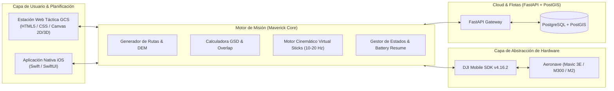

# DJI Maverick Pro GCS

> **Suite Avanzada de Planificación de Misiones, Fotogrametría y Control Autónomo para Drones DJI**  
> *Arquitectura cinemática en bucle cerrado (Virtual Sticks @ 10–20 Hz) compatible con DJI Mobile SDK v4.16.2.*

[](https://developer.dji.com/mobile-sdk/)
[]()
[]()
[]()

---

## 📖 Descripción General

**DJI Maverick Pro GCS** es una plataforma de software de aviación no tripulada (UAV) de nivel industrial diseñada para replicar y expandir el conjunto completo de capacidades de plataformas avanzadas como **Dronelink**. 

A diferencia de las misiones por waypoints integradas en el firmware básico del dron (limitadas en transiciones y curvas continuas), este sistema implementa un **motor cinemático de control en tiempo real mediante Palancas Virtuales (Virtual Sticks)**. El dispositivo móvil calcula una trayectoria continua espacio-temporal y envía comandos de velocidad y actitud al autopiloto a 10–20 Hz, garantizando trayectorias suaves, sincronización exacta de cámara y orientación dinámica hacia Puntos de Interés (POI).

---

## 🚀 Áreas Funcionales de la Aplicación

El sistema se estructura en torno a **cinco áreas funcionales clave**:

```
                               ┌────────────────────────────────────────────────┐
                               │            DJI MAVERICK PRO GCS                │
                               └──────────────────────┬─────────────────────────┘
        ┌───────────────────┬─────────────────────────┼───────────────────────┬──────────────────┐
        ▼                   ▼                         ▼                       ▼                  ▼
┌───────────────┐   ┌───────────────┐         ┌───────────────┐       ┌───────────────┐  ┌───────────────┐
│ 1. PRE-PLAN   │   │ 2. SURVEY     │         │ 3. ON-THE-FLY │       │ 4. SIMULATION │  │ 5. FLEET &    │
│ AUTOMATIZACIÓN│   │ FOTOGRAMETRÍA │         │ TIEMPO REAL   │       │ & SEGURIDAD   │  │ REPOSITORIOS  │
└───────────────┘   └───────────────┘         └───────────────┘       └───────────────┘  └───────────────┘
```

---

### 1. Automatización y Planificación de Vuelo (Pre-Planning)
* **Programación Tridimensional de Waypoints:** Generación de trayectorias complejas en 3D con control continuo de velocidad vectorial, transiciones curvas suavizadas (*fillet curves*) y cálculo de aceleración centrípeta.
* **Puntos de Interés Dinámicos (POI):** Algoritmos de apunte continuo de gimbal y rotación de rumbo (*yaw*) hacia objetivos 3D independientes de la dirección de desplazamiento de la aeronave.
* **Órbitas y Panorámicas 360°:** Creación de inspecciones orbitales cilíndricas de radio variable y secuencias automatizadas para panorámicas esféricas de 360 grados.
* **Árbol Jerárquico de Componentes (*List Components*):** Misiones estructuradas como árboles modulares y reutilizables de nodos ejecutables (`Mission` $\rightarrow$ `List Component` $\rightarrow$ `Sub-misiones` / `Acciones de Cámara`).
* **Lógica Condicional en Tiempo de Ejecución:** Bifurcaciones y reglas de decisión evaluadas según la telemetría en vivo (p. ej., umbral crítico de batería, satélites GNSS o velocidad del viento).

---

### 2. Mapeo, Topografía y Fotogrametría Avanzada
* **Mallas en Rejilla (Grid 2D):** Descomposición poligonal y cálculo de líneas de barrido nadir (*lawnmower*) optimizadas para ortomosaicos de alta resolución.
* **Rejilla Cruzada Oblicua (Crosshatch 3D):** Doble pasada cruzada con inclinación de gimbal configurable para reconstrucción fotogramétrica y modelado 3D de alta fidelidad.
* **Mapeo Lineal / Corredores (Corridor Mapping):** Misiones optimizadas para infraestructuras alargadas (carreteras, tendidos eléctricos, canales y gasoductos) con amortiguación en curvas.
* **Seguimiento de Terreno Dinámico (Terrain Follow / AGL):** Consulta de modelos digitales de elevación (DEM / SRTM) para mantener una distancia constante sobre el suelo (*Above Ground Level*), asegurando una escala constante en el terreno.
* **Control Matemático de Solapamiento:** Derivación óptica en tiempo real del tamaño de píxel en suelo (**GSD - Ground Sampling Distance** en cm/px), cadencia de disparo por distancia/tiempo y solapamientos frontal (60–90%) y lateral (50–85%).
* **Inspección de Fachadas Verticales:** Mallas fotogramétricas para escaneo detallado de estructuras verticales, presas, torres y edificios.

---

### 3. Funciones On-The-Fly (En Tiempo Real)
* **Modo Sígueme Dinámico (Dynamic Follow-Me):** Algoritmos de estimación de posición y filtro cinemático sobre las coordenadas GPS del control remoto o dispositivo móvil, con offsets ajustables (distancia, cota y ángulo).
* **Generación Instantánea de Misiones:** Creación sobre la marcha de órbitas de emergencia o inspecciones de área fija con un solo toque desde el aire.
* **Marcación de Waypoints en Vivo (*Drop Pin*):** Registro de waypoints y orientación de cámara utilizando la posición física y orientación real del dron durante el vuelo manual.

---

### 4. Simulación, Seguridad y Control de Calidad
* **Control Cinemático en Bucle Cerrado (Virtual Sticks):** Ejecución a 10–20 Hz de comandos vectoriales de cabeceo (*pitch*), alabeo (*roll*), velocidad vertical (*throttle*) y velocidad angular (*yaw rate*).
* **Previsualización y Simulación 3D:** Motor de simulación previa para recorrer temporalmente la misión, validar tiempos de vuelo, consumo de batería y detectar zonas ciegas o posibles colisiones.
* **Reanudación por Batería (Battery Swap Checkpoints):** Almacenamiento del cursor de misión en tiempo real (`component_id`, `distance_along_path`, `photos_taken`). Tras el aterrizaje por batería baja y el reemplazo de la misma, el sistema reanuda la misión en el punto exacto con una aproximación suave.
* **Verificación de Cámara y Gimbal:** Algoritmos de validación de encuadre, velocidad de obturación y telemetría de enfoque antes de iniciar disparos de misión.

---

### 5. Gestión de Flotas y Herramientas Enterprise
* **Repositorios Compartidos de Misión:** Sincronización multiusuario en la nube con control de versiones y permisos por piloto y organización.
* **Registro de Telemetría (*Blackbox Logs*):** Almacenamiento exhaustivo de vuelos a alta frecuencia (coordenadas, voltajes por celda, comandos enviados) con exportación a formatos estándar (CSV, KML, GeoJSON).
* **Georrectificación y Alineación Cartográfica:** Herramientas para alinear capas de mapas desactualizadas o compensar desvíos de ortofotos en campo mediante puntos de control de tierra (GCP).

---

## 🏗️ Arquitectura Técnica del Sistema



---

## 📂 Estructura del Repositorio

| Directorio / Archivo | Descripción |
| :--- | :--- |
| [`web/`](file:///Users/castordfedez/Desktop/DJIMaverick/web/) | Estación de Control Terrestre (GCS) táctica e interactiva (HUD, simulación, menús modernos y fotogrametría). |
| [`web/index.html`](file:///Users/castordfedez/Desktop/DJIMaverick/web/index.html) | Vista principal de la estación de control con las 5 áreas funcionales integradas. |
| [`web/styles.css`](file:///Users/castordfedez/Desktop/DJIMaverick/web/styles.css) | Sistema de diseño aeroespacial oscuro (*Aerospace Dark HUD*), glassmorphism y controles tácticos. |
| [`web/app.js`](file:///Users/castordfedez/Desktop/DJIMaverick/web/app.js) | Motor matemático fotogramétrico, bucle de simulación cinemática y renderizado canvas. |
| [`DJIMaverik.podspec`](file:///Users/castordfedez/Desktop/DJIMaverick/DJIMaverik.podspec) | Especificación CocoaPods para la integración con el DJI Mobile SDK para iOS. |
| [`Sample Code/`](file:///Users/castordfedez/Desktop/DJIMaverick/Sample%20Code/) | Proyectos de ejemplo en Objective-C y Swift proporcionados por el SDK. |
| [`docs/`](file:///Users/castordfedez/Desktop/DJIMaverick/docs/) | Documentación de API y guías de arquitectura del SDK. |

---

## ⚡ Inicio Rápido

### 1. Probar la Estación de Control Terrestre (GCS)
Para abrir y experimentar con los menús modernos, la calculadora fotogramétrica y la simulación interactiva:

```bash
# Opción A: Abrir directamente en el navegador (macOS)
open web/index.html

# Opción B: Iniciar servidor local
python3 -m http.server 4321 --directory web
# Luego visita: http://localhost:4321
```

### 2. Configurar el Entorno Móvil iOS (DJI Mobile SDK)
1. Instala CocoaPods en tu sistema:
   ```bash
   sudo gem install cocoapods
   ```
2. Navega al directorio de código Swift/ObjC de ejemplo y descarga las dependencias del SDK:
   ```bash
   cd "Sample Code/SwiftSampleCode"
   pod install
   ```
3. Abre el workspace generado en Xcode (`SwiftSampleCode.xcworkspace`).
4. Configura tu **DJI App Key** en el archivo `Info.plist` registrada en el [Portal de Desarrolladores de DJI](https://developer.dji.com).

---

## 🛡️ Licencia y Compatibilidad

* **Aeronaves Soportadas:** DJI Mavic 3 Enterprise Series, Mavic 2 Pro/Zoom, Mavic Air 2, Matrice 300 RTK, Phantom 4 Pro V2.0 y modelos compatibles con DJI Mobile SDK v4.
* **Licencia del SDK:** El DJI Mobile SDK está sujeto al [DJI End User License Agreement](http://developer.dji.com/policies/eula/).
